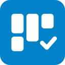
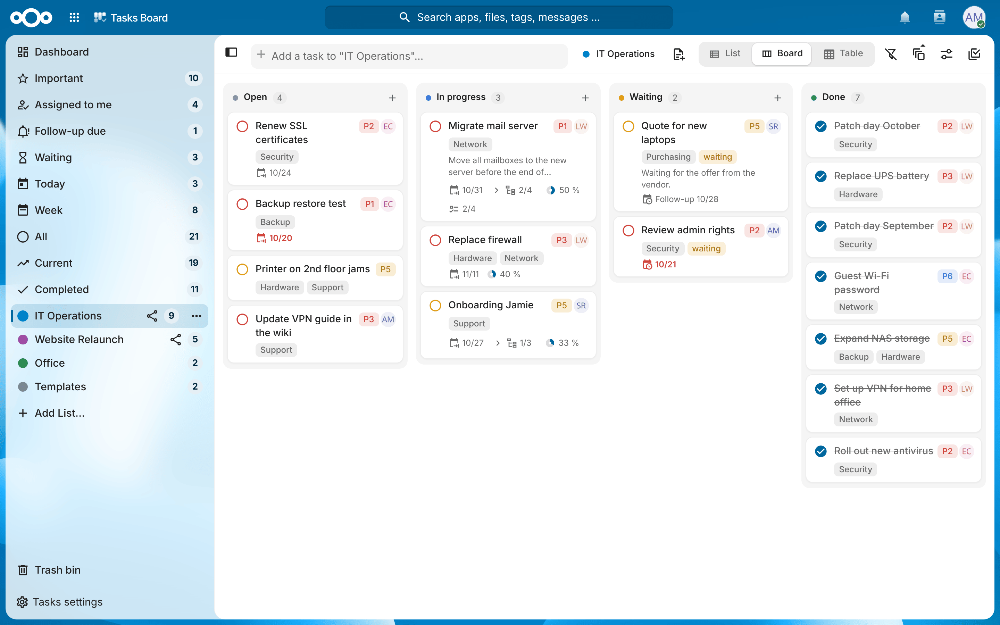
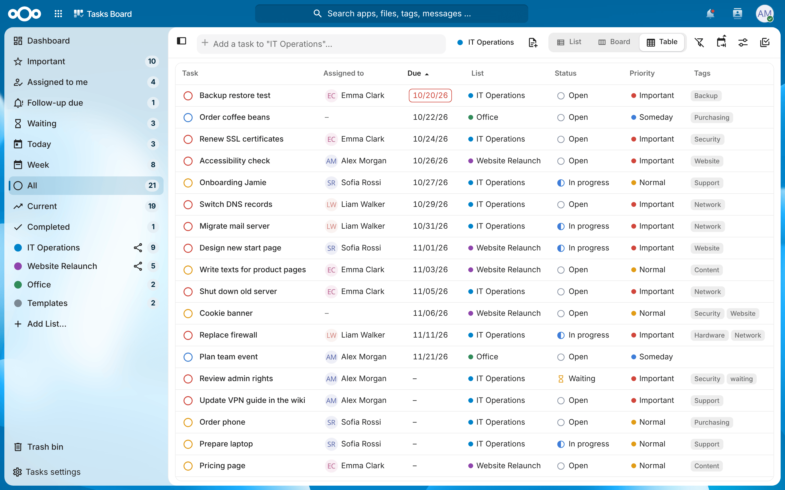
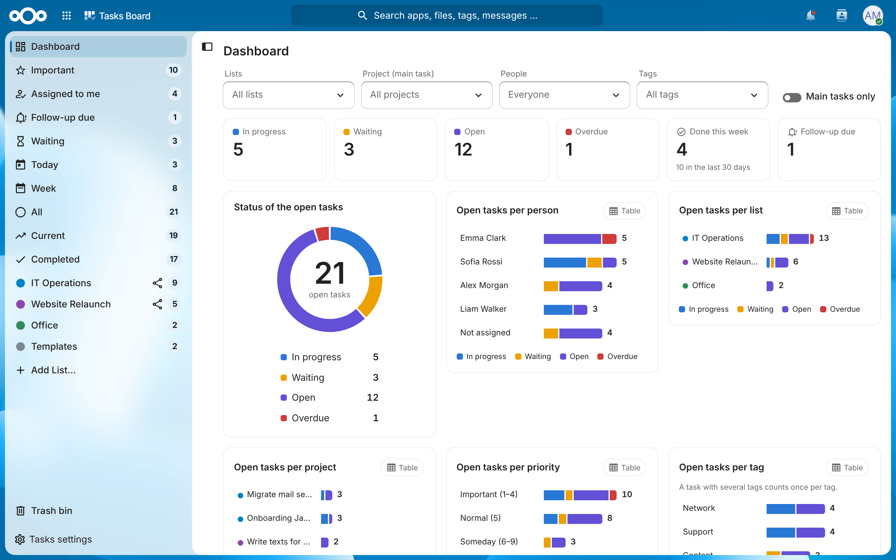
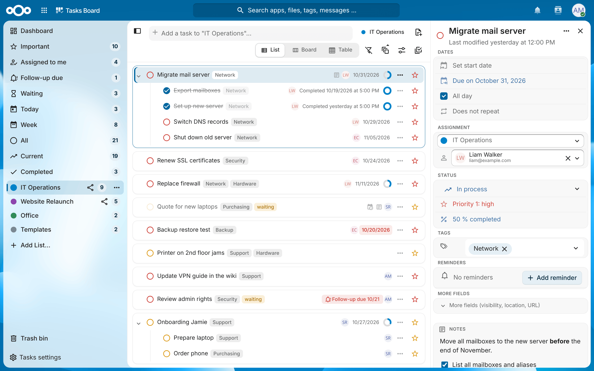
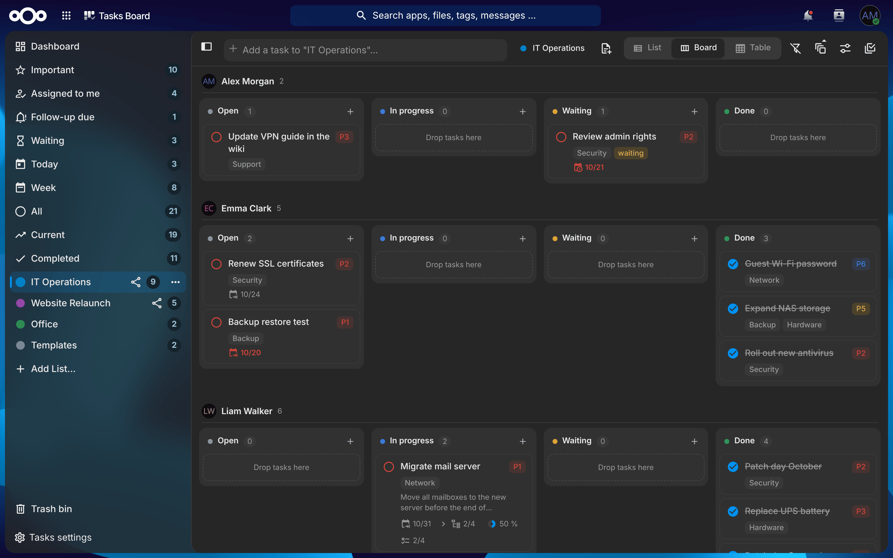
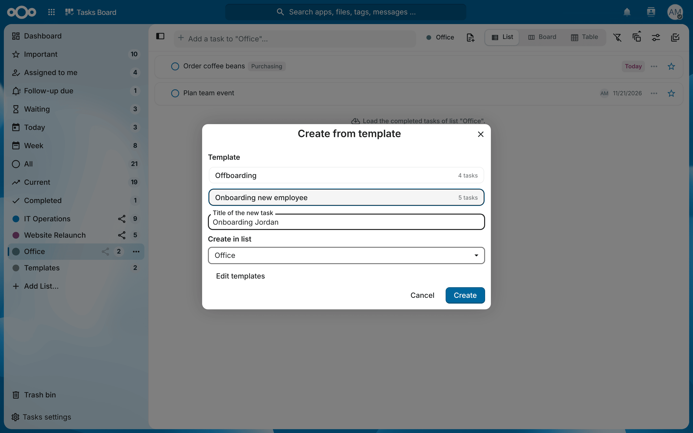
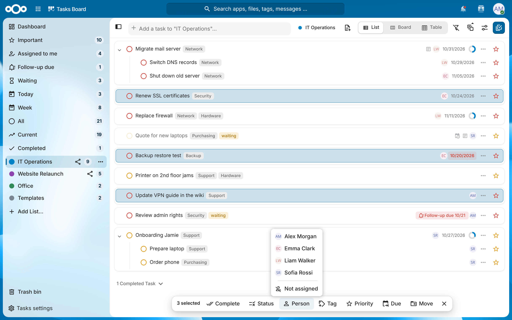

<p align="center">
  
</p>

<h1 align="center">Tasks Board</h1>

<p align="center">
  <strong>Board, table and dashboard for your <a href="https://nextcloud.com">Nextcloud</a> tasks.</strong><br>
  Assign tasks, keep track of what is waiting and see at a glance what is going on.
</p>

<p align="center">
  <a href="https://github.com/its-sven/Tasks-Board/releases"></a>
  <a href="https://github.com/its-sven/Tasks-Board/actions/workflows/ci.yml"></a>
  
  <a href="LICENSE"></a>
</p>

<p align="center">
  
</p>

Tasks Board is based on the [Nextcloud Tasks](https://github.com/nextcloud/tasks) app and uses the same CalDAV task lists. Both apps can be enabled side by side, so you can try it without moving any data, and every CalDAV client keeps working.

## Features

Everything the Tasks app does (lists, subtasks, smart collections, start and due dates, priorities, repeating tasks, sharing, CalDAV sync), and in addition:

**Views**

* **Board** (Kanban) with the columns Open, In progress, Waiting and Done (cancelled tasks on request). Drag cards between columns, sort them by hand, show rows per priority, list, main task, tag or person, open subtasks on the card.
* **Table** with columns you can show, hide, move and sort (title, person, start, due, list, main task, status, priority, tags, progress, overview, created, last modified). Status, priority, person and due date can be changed right in the cell.
* **Dashboard** with the current state, the distribution per person, list, project, priority and tag, the history of the last 12 weeks and the tasks that need attention (overdue, follow-up due, nobody assigned, important but untouched for two weeks). Filters for lists, project, persons and tags.
* **List** as cards or compact rows, collapsible subtasks, more sort orders (status, progress, person, list, main task), a separate order for subtasks and grouping by status, tag or priority.

**Working together**

* **Assign tasks** to one person who has access to the list (owner and everyone it is shared with, also via groups). Collection "Assigned to me", sorting, grouping, board rows and filter by person.
* **Notifications** when a task is assigned to you, when a task you assigned is completed, when a follow-up date is reached and when a task is due today. Each kind can be switched off.
* **Waiting and follow-up:** a task waits when it has the waiting tag or starts in the future. Collections "Waiting" and "Follow-up due", a dialog to pick the follow-up date and a reminder when it is reached.
* **Fixed tag list** that is suggested to everyone first. Tags that are not in the list are marked.

**Getting things done faster**

* **Templates:** a template list holds tasks with subtasks, "Create from template" copies them into any list.
* **Multi-select** with actions for all selected tasks (complete or reopen, status, person, tags, priority, due date, move to another list).
* **Notes editor** with a Markdown toolbar and checklists you can tick off directly in the sidebar.
* **Automatic progress** of main tasks from their subtasks; new subtasks take over priority, tags and person of the main task.
* **Keyboard shortcuts** (press `?` in the app), navigation and sidebar you can resize and collapse, light and dark theme.

## Screenshots

<table>
  <tr>
    <td width="50%"><br><sub><b>Table</b> – sortable columns, quick changes in the cells</sub></td>
    <td width="50%"><br><sub><b>Dashboard</b> – what is open, on whom and where (<a href="screenshots/dashboard-full.png">full page</a>)</sub></td>
  </tr>
  <tr>
    <td width="50%"><br><sub><b>List and sidebar</b> – assignment, status, tags and notes with checklists</sub></td>
    <td width="50%"><br><sub><b>Board per person</b> – here in the dark theme</sub></td>
  </tr>
  <tr>
    <td width="50%"><br><sub><b>Templates</b> – a task with all its subtasks in one go</sub></td>
    <td width="50%"><br><sub><b>Multi-select</b> – change many tasks at once</sub></td>
  </tr>
</table>

## Installation

### From a release

1. Download `tasks_board.tar.gz` from the [latest release](https://github.com/its-sven/Tasks-Board/releases/latest).
2. Extract it into the `apps` (or `custom_apps`) folder of your Nextcloud, so that the folder is called `tasks_board`.
3. Enable it under »Apps« or with `php occ app:enable tasks_board`.

Requirements: Nextcloud 31 or newer and PHP 8.2 or newer.

### From source

```bash
git clone https://github.com/its-sven/Tasks-Board.git tasks_board
cd tasks_board
npm ci
make appstore
```

The package is created in `build/artifacts/appstore/tasks_board.tar.gz`. Building needs Node.js and npm in the versions from `engines` in `package.json`.

## Settings

All settings are under »Tasks settings« at the bottom of the navigation:

* **For everyone:** automatic progress, notifications, template list, view options.
* **For administrators:** the fixed tag list and the waiting tag. Without a setting the waiting tag is `wartet` on instances whose default language is German and `waiting` otherwise.

The follow-up and due-today reminders are sent by a background job (hourly). Make sure the Nextcloud background jobs run via cron.

## FAQ

### Can I use Tasks Board and the Tasks app at the same time?

Yes. Both work on the same CalDAV task lists. Settings like views, columns and the tag list belong to Tasks Board only.

### Which apps sync with the task lists?

Tasks Board stores everything in standard CalDAV tasks (VTODO). Assignments are written as `ATTENDEE` with `SCHEDULE-AGENT=CLIENT`, so the server does not send invitation e-mails. All CalDAV clients that work with Nextcloud Tasks work with Tasks Board too, for example Thunderbird, Apple Reminders, DAVx⁵ with [jtx Board](https://jtx.techbee.at/), [OpenTasks](https://opentasks.app/) or [Tasks.org](https://tasks.org/), GNOME, KDE and [vdirsyncer](https://vdirsyncer.pimutils.org/). See the [list in the Tasks app](https://github.com/nextcloud/tasks#apps-which-sync-with-nextcloud-tasks-using-caldav).

### The app reports conflicts that do not exist

Like the Tasks app, Tasks Board uses the `ETag` HTTP header to detect conflicts. If `ETag`s are modified or removed (for example by anti-tracking browser extensions or a server configuration), the app reports conflicts that do not exist. See [nextcloud/tasks#2077](https://github.com/nextcloud/tasks/issues/2077) and [nextcloud/tasks#167](https://github.com/nextcloud/tasks/issues/167).

### Which languages are supported?

The parts that come from the Tasks app are translated into many languages. The new features are available in English and German so far, more translations are welcome (see [CONTRIBUTING.md](CONTRIBUTING.md)).

## Contributing

Bug reports, ideas and pull requests are welcome. [CONTRIBUTING.md](CONTRIBUTING.md) explains the development setup, the code layout and how to take over updates from Nextcloud Tasks. Releases are built automatically, see [docs/RELEASING.md](docs/RELEASING.md). Security issues: please see [SECURITY.md](SECURITY.md).

## Credits and license

Tasks Board is a fork of [Nextcloud Tasks](https://github.com/nextcloud/tasks) by [Raimund Schlüßler](https://github.com/raimund-schluessler) [and many more](https://github.com/nextcloud/tasks/graphs/contributors). All changes compared to Nextcloud Tasks are listed in the [changelog](CHANGELOG.md).

Licensed under the [GNU Affero General Public License v3.0 or later](LICENSE) (AGPL-3.0-or-later), like the Tasks app. Tasks Board is an independent project and not affiliated with Nextcloud GmbH; "Nextcloud" is a trademark of Nextcloud GmbH.
